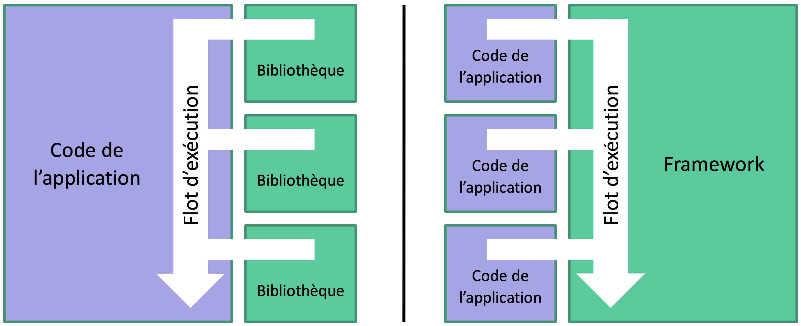
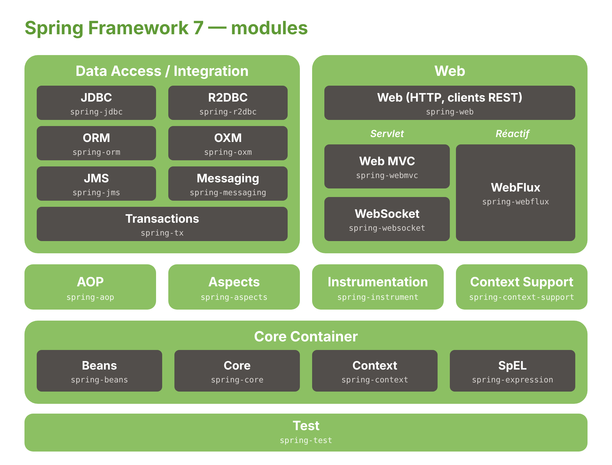

class: middle, center, title-slide
name: lecture7

# Web Dynamique côté Serveur
## 7. Spring
<br><br>
Simon BERNARD<br>
[simon.bernard@univ-rouen.fr](mailto:simon.bernard@univ-rouen.fr)<br><br>
.center.height-4em[]

---
class: middle, center
# Présentation de Spring Framework

---
# Jakarta EE vs Spring

|  | Jakarta EE | Spring |
|---------|--------------|--------|
| Philosophie | **Container-based** - basé sur des API standards et des services externes, mise en oeuvre par le conteneur | **Lightweight** - embarque les services dont elle a besoin, et parfois même son propre conteneur (Spring Boot) |
| Difficulté d'utilisation | Élevé au début mais n'augmente pas avec la taille de l'architecture | Simple à prendre en main mais devient complexe avec la taille de l'architecture |
| Points forts | Standard (*write once, run anywhere*), robuste et maintenable | Développement rapide, flexible, modulaire et léger (*use only what you need*) |
| Cas d'usage type | Applications d'entreprise avec architecture complexe | Applications web et microservices |

---
# Centré sur l'inversion de contrôle (IoC)

.box[IoC est un patron d'architecture commun à tous les frameworks: le flot d'exécution n'est plus sous le contrôle direct de l'application mais est délégué à un conteneur. Le conteneur est responsable de l'instanciation des objets et de la gestion de leur cycle de vie.]

.center.width-70[]

---
count: false
# Centré sur l'inversion de contrôle (IoC)

.box.mb-4[IoC est un patron d'architecture commun à tous les frameworks: le flot d'exécution n'est plus sous le contrôle direct de l'application mais est délégué à un conteneur. Le conteneur est responsable de l'instanciation des objets et de la gestion de leur cycle de vie.]

- Spring fournit l'environnement d'exécution, c'est-à-dire:
  - le conteneur IoC 
  - les modules pour la prise en charge des autres services
- Le développeur fournit les composants et leur configuration, c'est-à-dire:
  - des beans (POJOs)
  - des fichiers de configuration (XML) ou des annotations
- Déploiement sur un serveur léger (i.e. conteneur de servlet) car pas besoin des autres API Jakarta

---
# L'écosystème Spring

- Spring Framework: le framework de base
- L'écosystème .exponent[(1)] : 21 projets bâtis sur Spring Framework, dont:
    - Spring Boot: pour simplifier la configuration et le déploiement
    - Spring Data: pour l'accès aux données
    - Spring Security: pour la sécurité
    - Spring Cloud: pour le développement de microservices
    - Spring AI: pour l'intégration de l'IA dans les applications Spring
- Ces projets fournissent des modules qui peuvent être utilisés indépendamment ou combinés selon les besoins
- Par ex., pour créer une API REST, on va utiliser un *starter* Spring Boot et y inclure les modules:
    - Spring Web (accès aux requêtes HTTP et aux vues)
    - Spring Data JPA (accès aux données relationnelles)
    - Spring Security (authentification et autorisation)

.footnote[(1) [https://spring.io/projects](https://spring.io/projects)]

---
# Les modules de Spring Framework

.center.width-75[]

---
class: middle, center
# Spring Core

---
# Le conteneur IoC de Spring

- Même principe que CDI: un conteneur crée, assemble et gère le cycle de vie des composants de l'application
- Ces composants sont des **beans**, i.e. POJO annotés
- Contrairement à CDI, le conteneur n'est pas fourni par un serveur, il est **embarqué** dans l'application
- Le conteneur est représenté par l'interface `ApplicationContext`
```java
    ApplicationContext context = new AnnotationConfigApplicationContext(AppConfig.class);
    CoffeeService coffeeService = context.getBean(CoffeeService.class);
    Coffee coffee = coffeeService.makeCoffee(2, 1);
```
- En pratique, on n'appelle presque jamais `getBean` : c'est le conteneur qui injecte les dépendances

---
# Le conteneur IoC de Spring

- Le conteneur doit connaître les classes à gérer: il faut déclarer les beans
- Pour cela, trois façons de faire: 
    1. des annotations sur les classes (`@Component`, `@Service`, ...)
    2. des classes de configuration Java (`@Configuration`)
    3. des fichiers XML (historique, encore présent dans du code ancien)
- Dans:
```java
    ApplicationContext context = new AnnotationConfigApplicationContext(**AppConfig**.class);
```
`AppConfig` est une classe de configuration Java qui déclare les beans et leurs dépendances


---
# Déclarer des beans par annotations

- Une classe devient un bean si elle est annotée par un **stéréotype**

| Annotation | Rôle |
|------------|------|
| `@Component` | bean générique |
| `@Service` | couche métier |
| `@Repository` | couche d'accès aux données (traduit les exceptions de persistance) |
| `@Controller`, `@RestController` | couche web (Spring MVC) |

- `@Service`, `@Repository` et `@Controller` sont des spécialisations de `@Component` : même effet technique, mais l'intention est explicite
- Le conteneur détecte les classes annotées grâce au **scan de composants**
```java
    @Configuration
    @ComponentScan("fr.univrouen.coffeeapp")
    public class AppConfig { }
```
```java
    @Component
    public class FilterCoffeeMachine implements CoffeeMachine { ... }
```

---
# Déclarer des beans en Java

- Pour les classes que l'on ne peut pas annoter (bibliothèques externes) ou dont la création demande de la logique
- Méthode annotée `@Bean` dans une classe `@Configuration` : c'est l'équivalent des méthodes *producer* de CDI
```java
    @Configuration
    public class AppConfig {
        @Bean
        public CoffeeConfiguration coffeeConfiguration() {
            CoffeeType type = new CoffeeType("Medium Fine", 0.5);
            return new CoffeeConfiguration(type, 0.7, 550);
        }
        @Bean
        public CoffeeMachine coffeeMachine(CoffeeConfiguration config) {
            return new FilterCoffeeMachine(config);
        }
    }
```
- Le nom du bean est le nom de la méthode (ici `coffeeMachine`)
- Les paramètres de la méthode sont eux-mêmes injectés par le conteneur
- Comparer avec l'assemblage « à la main » du chapitre 4 : le conteneur se charge de l'ordre de création

---
# Injection de dépendances

- Par constructeur (**recommandée**) :
```java
    @Service
    public class CoffeeService {
        private final CoffeeMachine coffeeMachine;
        public CoffeeService(CoffeeMachine coffeeMachine) {
            this.coffeeMachine = coffeeMachine;
        }
    }
```
- L'annotation `@Autowired` (équivalent de `@Inject`) est facultative quand la classe n'a qu'un constructeur
- Par setter ou par attribut, avec `@Autowired` :
```java
    @Service
    public class CoffeeService {
        @Autowired
        private CoffeeMachine coffeeMachine;
        ...
    }
```
- L'injection par attribut est concise mais déconseillée : dépendances cachées, test impossible sans le conteneur
- Spring reconnaît aussi l'annotation `@Inject` de Jakarta

---
# Résolution des ambiguïtés

- Même problème qu'en CDI : plusieurs beans du même type → exception au démarrage (`NoUniqueBeanDefinitionException`)
- `@Primary` désigne le bean choisi par défaut
- `@Qualifier("nom")` désigne explicitement le bean à injecter (pas besoin de définir une annotation comme en CDI)
```java
    @Component
    @Primary
    public class FilterCoffeeMachine implements CoffeeMachine { ... }
```
```java
    @Component("espresso")
    public class EspressoCoffeeMachine implements CoffeeMachine { ... }
```
```java
    @Service
    public class CoffeeService {
        private final CoffeeMachine coffeeMachine;
        public CoffeeService(@Qualifier("espresso") CoffeeMachine coffeeMachine) {
            this.coffeeMachine = coffeeMachine;
        }
    }
```
- On peut aussi injecter tous les beans d'un type : `List<CoffeeMachine> machines`

---
# Portée des beans

- Annotation `@Scope` (ou raccourci) sur la classe ou sur la méthode `@Bean`

| Portée Spring | Équivalent CDI | Nombre d'instances |
|---------------|----------------|--------------------|
| `singleton` (**par défaut**) | `@ApplicationScoped` | une seule pour tout le conteneur |
| `prototype` | `@Dependent` | une nouvelle à chaque injection |
| `request` (`@RequestScope`) | `@RequestScoped` | une par requête HTTP |
| `session` (`@SessionScope`) | `@SessionScoped` | une par session HTTP |

```java
    @Component
    @SessionScope
    public class ShoppingCart { ... }
```

.box[Attention : la portée par défaut est `singleton` en Spring, alors qu'elle est `@Dependent` en CDI. Un singleton est partagé par toutes les requêtes (donc tous les threads) : il doit être **sans état**, c'est-à-dire sans attribut modifiable propre à un utilisateur.]

---
# Cycle de vie d'un bean

1. Instanciation (appel du constructeur)
2. Injection des dépendances
3. Initialisation : méthode annotée `@PostConstruct`
4. Utilisation
5. Destruction à la fermeture du conteneur : méthode annotée `@PreDestroy`

```java
    @Component
    public class FilterCoffeeMachine implements CoffeeMachine {
        @PostConstruct
        public void heatUp() { System.out.println("Machine en chauffe"); }
        @PreDestroy
        public void clean() { System.out.println("Nettoyage de la machine"); }
        ...
    }
```
- Mêmes annotations Jakarta qu'en CDI (`jakarta.annotation`)
- Pour une classe externe : `@Bean(initMethod = "start", destroyMethod = "stop")`
- Les singletons sont créés dès le démarrage du conteneur (sauf `@Lazy`) : une erreur de configuration est détectée immédiatement

---
# En résumé : CDI vs Spring Core

|  | Jakarta CDI | Spring Core |
|--|-------------|-------------|
| Conteneur | fourni par le serveur d'application | `ApplicationContext`, embarqué dans l'application |
| Déclarer un bean | annotation de portée (`@RequestScoped`, ...) | stéréotype (`@Component`, `@Service`, ...) |
| Méthode productrice | `@Produces` | `@Bean` dans une classe `@Configuration` |
| Injection | `@Inject` | `@Autowired` (ou rien si constructeur unique) |
| Désambiguïsation | *qualifier* à définir | `@Qualifier("nom")`, `@Primary` |
| Portée par défaut | `@Dependent` | `singleton` |
| Cycle de vie | `@PostConstruct`, `@PreDestroy` | `@PostConstruct`, `@PreDestroy` |
| Intercepteurs | `@Interceptor`, `@AroundInvoke` | AOP (`@Aspect`, `@Around`) |

- Les concepts sont les mêmes : passer de l'un à l'autre est surtout une question de vocabulaire

---
class: middle, center
# Spring MVC

---
# Spring MVC

- Module web « historique » de Spring Framework (`spring-webmvc`), bâti sur l'API Servlet
- Implémente le patron MVC pour le Web (cf. chapitre 1) avec un **contrôleur frontal** (*front controller*) : la `DispatcherServlet`
- La `DispatcherServlet` est une servlet (cf. chapitre 2) qui reçoit toutes les requêtes et les délègue aux contrôleurs de l'application
- Deux usages :
  - application orientée présentation : le contrôleur renvoie une **vue** HTML, comme Servlet + JSP (chapitre 3) ou Faces (chapitre 5)
  - service web RESTful : le contrôleur renvoie des **données** (JSON), comme Jakarta REST (chapitre 6)
- Les contrôleurs sont des beans Spring : ils bénéficient de l'injection de dépendances

---
# Traitement d'une requête

1. La requête HTTP du client est reçue par la `DispatcherServlet`
2. La `DispatcherServlet` interroge les `HandlerMapping` pour trouver la méthode de contrôleur associée à l'URL et à la méthode HTTP
3. Le contrôleur traite la requête (en s'appuyant sur les services) et renvoie :
  - soit un nom de vue et un modèle (application orientée présentation)
  - soit un objet (service REST)
4. Cas d'une vue : le `ViewResolver` trouve le template (Thymeleaf, JSP...) qui génère le HTML à partir du modèle
5. Cas d'un objet : un `HttpMessageConverter` le sérialise dans le corps de la réponse (JSON avec Jackson)
6. La réponse est renvoyée au client

.box[La `DispatcherServlet` remplace la servlet contrôleur écrite à la main au chapitre 3 : le routage, la conversion des paramètres et le `forward` vers la vue sont pris en charge par le framework.]

---
# Contrôleur et vue

```java
    @Controller
    public class CoffeeController {
        private final CoffeeService coffeeService;
        public CoffeeController(CoffeeService coffeeService) {
            this.coffeeService = coffeeService;
        }
        @GetMapping("/coffee")
        public String makeCoffee(@RequestParam(defaultValue = "2") int strength, Model model) {
            Coffee coffee = coffeeService.makeCoffee(strength, 1);
            model.addAttribute("coffee", coffee);
            return "coffee";    // nom logique de la vue
        }
    }
```
- Comparer avec `CoffeeServlet` du chapitre 4 : plus de `doGet`, de `request.setAttribute` ni de `RequestDispatcher`
- Le nom logique `"coffee"` est résolu en un template, par exemple `templates/coffee.html` avec Thymeleaf :
```html
    <h1>Votre café</h1>
    <p th:text="${coffee.name}">nom du café</p>
```
- Thymeleaf est le moteur de templates HTML le plus utilisé avec Spring (JSP reste possible mais déconseillé)

---
# Mapping des requêtes

- `@RequestMapping` sur la classe : préfixe d'URL commun à toutes les méthodes
- `@GetMapping`, `@PostMapping`, `@PutMapping`, `@DeleteMapping`, `@PatchMapping` sur les méthodes
- Les données de la requête sont récupérées en annotant les paramètres de la méthode :

| Annotation | Source | Exemple |
|------------|--------|---------|
| `@PathVariable` | segment de l'URL | `/books/{id}` |
| `@RequestParam` | paramètre de requête ou de formulaire | `/books?author=Hugo` |
| `@RequestBody` | corps de la requête (JSON → objet Java) | `POST /books` |
| `@RequestHeader` | en-tête HTTP | `Accept-Language` |
| `@CookieValue` | cookie | `JSESSIONID` |

- Autres paramètres injectables : `HttpServletRequest`, `HttpSession`, `Model`, ...
- Conversion automatique des types (`String` → `int`, `LocalDate`, ...)

---
# Services web RESTful

- `@RestController` = `@Controller` + `@ResponseBody` : la valeur de retour est sérialisée dans le corps de la réponse
```java
    @RestController
    @RequestMapping("/books")
    public class BookController {
        private final BookService bookService;
        public BookController(BookService bookService) { this.bookService = bookService; }

        @GetMapping
        public List<Book> getAll() { return bookService.findAll(); }

        @GetMapping("/{id}")
        public ResponseEntity<Book> getById(@PathVariable Long id) {
            return bookService.findById(id)
                    .map(ResponseEntity::ok)
                    .orElse(ResponseEntity.notFound().build());
        }

        @PostMapping
        public ResponseEntity<Book> create(@RequestBody Book book) {
            Book saved = bookService.save(book);
            return ResponseEntity.created(URI.create("/books/" + saved.getId())).body(saved);
        }
    }
```
- `ResponseEntity` joue le rôle de `Response` en Jakarta REST : code HTTP, en-têtes et corps

---
# Jakarta REST vs Spring MVC

| Jakarta REST | Spring MVC |
|--------------|------------|
| `@Path("/books")` sur la classe | `@RequestMapping("/books")` |
| `@GET`, `@POST`, `@PUT`, `@DELETE` | `@GetMapping`, `@PostMapping`, `@PutMapping`, `@DeleteMapping` |
| `@GET @Path("/{id}")` sur la méthode | `@GetMapping("/{id}")` |
| `@PathParam("id")` | `@PathVariable` |
| `@QueryParam("author")` | `@RequestParam` |
| paramètre non annoté (entité) | `@RequestBody` |
| `@Produces`, `@Consumes` | attributs `produces`, `consumes` |
| `Response` | `ResponseEntity` |
| API client (`Client`, `WebTarget`) | `RestClient` |

- Mêmes concepts, syntaxe différente : le projet `bookrest` du chapitre 6 se traduit presque ligne à ligne

---
# Validation et gestion des erreurs

- Validation déclarative avec Jakarta Bean Validation : contraintes sur le modèle et `@Valid` sur le paramètre
```java
    public class Book {
        @NotBlank
        private String title;
        @PositiveOrZero
        private double price;
        ...
    }
```
```java
    @PostMapping
    public ResponseEntity<Book> create(@Valid @RequestBody Book book) { ... }
```
- Si l'objet est invalide, Spring répond automatiquement `400 Bad Request`
- Gestion centralisée des exceptions avec `@RestControllerAdvice` :
```java
    @RestControllerAdvice
    public class ErrorHandler {
        @ExceptionHandler(BookNotFoundException.class)
        public ResponseEntity<String> handleNotFound(BookNotFoundException e) {
            return ResponseEntity.status(HttpStatus.NOT_FOUND).body(e.getMessage());
        }
    }
```

---
# Configurer Spring MVC « à la main »

- Sans Spring Boot, il faut :
  - déclarer toutes les dépendances (Spring, Jackson, Thymeleaf...) en choisissant des versions compatibles
  - enregistrer la `DispatcherServlet` auprès du conteneur de servlets
  - activer et configurer Spring MVC (`@EnableWebMvc`, résolveur de vues, convertisseurs...)
  - packager en `war` et déployer sur un serveur (Tomcat, ...)
- Par exemple :
```java
    public class WebInitializer extends AbstractAnnotationConfigDispatcherServletInitializer {
        @Override
        protected Class<?>[] getRootConfigClasses() { return new Class<?>[] { AppConfig.class }; }
        @Override
        protected Class<?>[] getServletConfigClasses() { return new Class<?>[] { WebConfig.class }; }
        @Override
        protected String[] getServletMappings() { return new String[] { "/" }; }
    }
```
```java
    @Configuration
    @EnableWebMvc
    @ComponentScan("fr.univrouen.bookapp.web")
    public class WebConfig implements WebMvcConfigurer { ... }
```
- Une configuration répétée d'un projet à l'autre... c'est le problème que résout Spring Boot

---
class: middle, center
# Spring Boot

---
# Spring Boot

- Projet de l'écosystème Spring (2014) pour créer rapidement des applications Spring prêtes à l'emploi
- **Ce n'est pas un nouveau framework** : on utilise toujours Spring Framework (Core, MVC...), Spring Boot le configure à notre place
- Approche *opinionated* (*convention over configuration*) : des choix par défaut raisonnables, que l'on peut surcharger
- Principaux apports :
  - **starters** : des dépendances regroupées par fonctionnalité, aux versions compatibles
  - **auto-configuration** : les beans d'infrastructure sont créés selon ce qui est présent dans le projet
  - **serveur embarqué** : l'application est un `jar` exécutable (`java -jar`)
  - **configuration externalisée** : `application.properties`, profils, variables d'environnement
  - **outils de production** : supervision avec Actuator (santé, métriques)
- Version actuelle : Spring Boot 4, basé sur Spring Framework 7 (Java 17 minimum)

---
# Créer un projet : Spring Initializr

- Générateur en ligne [start.spring.io](https://start.spring.io), intégré à VS Code et IntelliJ
- On choisit l'outil de build (Maven, Gradle), la version de Java et de Spring Boot, le packaging et les dépendances
```
    bookapp/
    ├── pom.xml
    ├── mvnw, mvnw.cmd                  # Maven Wrapper
    └── src/
        ├── main/
        │   ├── java/fr/univrouen/bookapp/
        │   │   └── BookappApplication.java
        │   └── resources/
        │       ├── application.properties
        │       ├── static/             # CSS, JS, images
        │       └── templates/          # vues Thymeleaf
        └── test/java/fr/univrouen/bookapp/
            └── BookappApplicationTests.java
```
- Plus de dossier `webapp/WEB-INF` ni de `web.xml` (cf. structure d'une application Jakarta EE, chapitre 1)

---
# Les starters

```xml
    <parent>
        <groupId>org.springframework.boot</groupId>
        <artifactId>spring-boot-starter-parent</artifactId>
        <version>4.0.0</version>
    </parent>
    <dependencies>
        <dependency>
            <groupId>org.springframework.boot</groupId>
            <artifactId>spring-boot-starter-webmvc</artifactId>
        </dependency>
        <dependency>
            <groupId>org.springframework.boot</groupId>
            <artifactId>spring-boot-starter-data-jpa</artifactId>
        </dependency>
        <dependency>
            <groupId>com.h2database</groupId>
            <artifactId>h2</artifactId>
            <scope>runtime</scope>
        </dependency>
    </dependencies>
```
- Un starter regroupe toutes les dépendances nécessaires à une fonctionnalité
- Aucune version à préciser : elles sont gérées par le parent `spring-boot-starter-parent`
- `spring-boot-starter-webmvc` = Spring MVC + Jackson + Tomcat embarqué (nommé `spring-boot-starter-web` avant Spring Boot 4)

---
# La classe principale

```java
    @SpringBootApplication
    public class BookappApplication {
        public static void main(String[] args) {
            SpringApplication.run(BookappApplication.class, args);
        }
    }
```
- `@SpringBootApplication` regroupe trois annotations :
  - `@SpringBootConfiguration` (une `@Configuration`) : la classe peut déclarer des `@Bean`
  - `@ComponentScan` : scan du package de la classe et de ses sous-packages
  - `@EnableAutoConfiguration` : active l'auto-configuration
- `SpringApplication.run` crée l'`ApplicationContext` et démarre le serveur embarqué
- Lancement : `./mvnw spring-boot:run` ou `java -jar target/bookapp.jar`

.box[Inversion par rapport à Jakarta EE : ce n'est plus l'application qui est déployée dans un serveur, c'est le serveur qui est embarqué dans l'application.]

---
# L'auto-configuration

- Spring Boot crée les beans d'infrastructure en fonction des bibliothèques présentes dans le classpath et de la configuration
- Exemples :
  - Spring MVC présent → `DispatcherServlet`, convertisseurs JSON, Tomcat embarqué sur le port 8080
  - Thymeleaf présent → `ViewResolver` vers `templates/*.html`
  - JPA et H2 présents → `DataSource` en mémoire, `EntityManagerFactory`, gestionnaire de transactions
- Repose sur des configurations conditionnelles (exemple simplifié) :
```java
    @AutoConfiguration
    @ConditionalOnClass(DataSource.class)
    public class DataSourceAutoConfiguration {
        @Bean
        @ConditionalOnMissingBean
        public DataSource dataSource(DataSourceProperties properties) { ... }
    }
```
- `@ConditionalOnMissingBean` : si le développeur déclare son propre bean, c'est lui qui est utilisé
- Pour savoir ce qui a été configuré : `debug=true` dans `application.properties` (rapport affiché au démarrage)

---
# Configuration externalisée

- Fichier `application.properties` (ou `application.yml`) dans `src/main/resources`
```properties
    server.port=8081
    spring.datasource.url=jdbc:h2:mem:bookdb
    spring.jpa.show-sql=true
    bookapp.page-size=20
```
- Injection d'une valeur dans un bean :
```java
    @Service
    public class BookService {
        public BookService(BookRepository repository, @Value("${bookapp.page-size}") int pageSize) { ... }
    }
```
- Ou regroupement typé avec `@ConfigurationProperties(prefix = "bookapp")`
- **Profils** : `application-dev.properties`, `application-prod.properties`, activés avec `spring.profiles.active=dev`
- Surcharge par variables d'environnement ou en ligne de commande (`--server.port=9090`) : le même `jar` pour tous les environnements

---
# Accès aux données avec Spring Data JPA

- `spring-boot-starter-data-jpa` : Jakarta Persistence (JPA, implémentée par Hibernate) + Spring Data
- Une entité JPA classique...
```java
    @Entity
    public class Book {
        @Id @GeneratedValue
        private Long id;
        private String title;
        private String author;
        ...
    }
```
- ... et un *repository* réduit à une interface :
```java
    public interface BookRepository extends JpaRepository<Book, Long> {
        List<Book> findByAuthor(String author);
    }
```
- Aucune implémentation à écrire : Spring Data la génère au démarrage
- Opérations CRUD fournies : `save`, `findById`, `findAll`, `deleteById`, ...
- Requêtes dérivées du nom de la méthode (`findByAuthorAndTitle`, `countByAuthor`...) ou écrites avec `@Query`
- Le *repository* est un bean : on l'injecte dans `BookService`

---
# Tester une application Spring Boot

- Starters de test : JUnit, AssertJ, Mockito et les outils de test Spring
- Tests de « tranches » : seule une partie du contexte est chargée
  - `@WebMvcTest` : couche web (contrôleurs), sans serveur réel
  - `@DataJpaTest` : couche persistance, avec une base en mémoire
  - `@SpringBootTest` : application complète
- Exemple : test de la couche web
```java
    @WebMvcTest(BookController.class)
    class BookControllerTest {
        @Autowired
        MockMvc mvc;
        @MockitoBean
        BookService bookService;
        @Test
        void unknownBookReturns404() throws Exception {
            when(bookService.findById(42L)).thenReturn(Optional.empty());
            mvc.perform(get("/books/42")).andExpect(status().isNotFound());
        }
    }
```
- L'injection par constructeur facilite aussi les tests unitaires purs, sans Spring

---
# Pour aller plus loin

- **DevTools** (`spring-boot-devtools`) : redémarrage automatique à chaque modification du code
- **Actuator** (`spring-boot-starter-actuator`) : points d'accès de supervision (`/actuator/health`, `/actuator/metrics`, ...)
- **Spring Security** : authentification et autorisation, auto-configurée dès l'ajout du starter
- **Packaging** :
  - `jar` exécutable (par défaut), facile à conteneuriser (Docker)
  - `war` toujours possible pour un déploiement sur un serveur existant
  - image native GraalVM : démarrage en quelques millisecondes
- **Spring Cloud** : configuration centralisée, découverte de services... pour les architectures microservices (cf. chapitre 1)

---
# En résumé...

- **Spring Core** : un conteneur IoC qui gère des beans et injecte leurs dépendances
  - mêmes concepts que CDI ; attention à la portée par défaut (`singleton`)
- **Spring MVC** : une `DispatcherServlet` comme contrôleur frontal
  - `@Controller` + vue pour les applications orientées présentation (≈ Servlet + JSP)
  - `@RestController` pour les services web RESTful (≈ Jakarta REST)
- **Spring Boot** : starters, auto-configuration, serveur embarqué, configuration externalisée
  - on écrit le même code Spring, sans la configuration d'infrastructure
  - c'est aujourd'hui le point d'entrée quasi systématique d'un projet Spring

---
class: middle, dark-slide

# Live coding: Le projet `bookapp`
